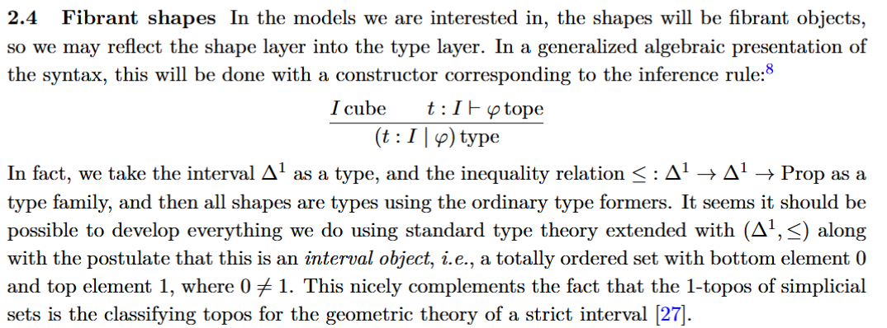

# A new presentation of sHoTT

Instead of having extension types (also cubes and topes, accordingly,) some recent papers use an alternative way, which was anticipated in this paper:

(*Buchholtz, Ulrik, and Weinberger, Jonathan, Synthetic fibered $(\infty,1)$-category theory, arXiv, 2022.*)

In the paper "Directed univalence in simplicial homotopy type theory", for example, they define everything out of one axiom on the directed interval $\mathbb{I}$.

I'm going to explain how this works.